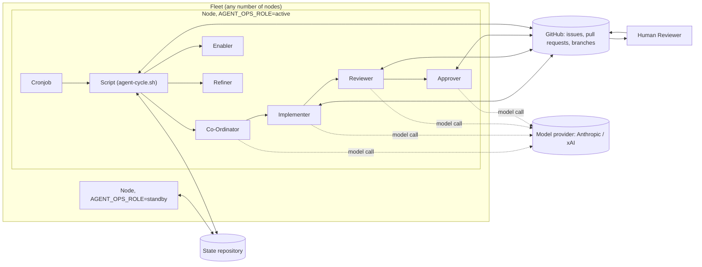

# Architecture

This page is the overview no single file in this repository otherwise
gives: the three pipelines, the actors each one launches, the node a
pipeline runs on, the state a fleet of nodes shares, and what it costs to
run. Each claim below cites the requirement, decision, or guide section
that is authoritative for it; read that source for the full detail. For the
step-by-step path one piece of work takes through these actors, see
[The life of an item](life-of-an-item.md).

## The three pipelines

Three independent pipelines exist, each its own entry point and its own
as-built specification:

- **The implementation cycle** (`agent-cycle.sh`) — on a configured cadence,
  picks at most one well-scoped item of pending work, implements it on a
  feature branch in an ephemeral clone, reviews and corrects the result, and
  leaves a mergeable pull request for approval and landing. This is the
  pipeline the rest of this page, and the next four pages, describe in
  depth.
  Authoritative: `docs/spec/implementation/README.md` § "What it is".
- **The repository-review cycle** (`review-cycle.sh`) — runs a single
  Reviewer-Agent that performs a full review of the target repository and
  raises its findings as a pull request, independently of the implementation
  cycle's own Reviewer stage.
  Authoritative: `docs/spec/review/README.md` § "What it is".
- **The Pipeline Monitor** (`monitor-cycle.sh`) — a scheduled reading of the
  other two pipelines' own recorded state. It never runs as a stage of
  `agent-cycle.sh`. Its mechanical findings are filed as `pw::type:tech-debt`
  issues, which the implementation cycle's own `tech-debt` source then
  selects.
  Authoritative: `docs/spec/monitor.md` § "What it is";
  `docs/spec/implementation/README.md` § "Actors", item 10.

## Actors

Every actor the implementation pipeline launches, and the two sibling
actors from the other pipelines:

1. **Cronjob** — the crontab entry that fires the Script.
2. **Script** (`agent-cycle.sh`) — a bash script that orchestrates one whole
   cycle. See "The Script is the only launcher of agents" below.
3. **Co-Ordinator** — a headless Claude Code invocation that selects one
   item of work and emits a work order. It does not implement anything.
4. **Implementer** — a headless Claude Code invocation that carries out the
   work order and raises a draft pull request.
5. **Reviewer** — a headless Claude Code invocation that checks and
   corrects the Implementer's branch, then marks the pull request ready.
6. **Approver** — engaged only where `merge_autonomy` is above `human`;
   independently judges a pull request the Reviewer has already marked
   ready, and returns a verdict the Script turns into a real GitHub review
   under a non-author GitHub App identity ("Pullwright Approver"), never
   under this system's own authoring identity.
7. **Human Reviewer** — gives final approval at `human`, or an additional
   one above `human`; merges directly at `human`/`agent-approves`; at
   `agent-merges-routine`/`agent-merges-all` the arming step lands an
   eligible pull request itself, and the Human Reviewer's role narrows to
   whatever that classifier did not cover. Not launched by any part of this
   system.
8. **Enabler** — engaged rarely, at the end of a cycle; re-examines items
   recorded as blocked which the pipeline has not cleared itself. Writes no
   code and raises no pull request. See [Escalation](escalation.md).
9. **Refiner** — engaged at the same end-of-cycle point, immediately after
   the Enabler; writes the specification an under-specified item lacks
   before it has to be blocked and wait for the Enabler. Writes no code,
   raises no pull request, and can neither escalate nor void.
10. **Project Reviewer** (token `project-reviewer`) — the repository-review
    pipeline's single agent; called the Reviewer-Agent at its own spec.
11. **Pipeline Monitor** (token `monitor`) — the Monitor pipeline's single
    agent.

Authoritative: `docs/spec/implementation/README.md` § "Actors", items 1–10
(numbered 5a for the Approver and 6–10 for everything from the Human
Reviewer on, since inserting 5a shifts every item after it by one against
this page's own sequential 1–11); `docs/spec/review/README.md` § "Actors";
`docs/spec/monitor.md` § "Actors".

## The Script is the only launcher of agents

No agent ever launches another agent. The Script launches every one of the
headless Claude Code invocations above, sequentially, within one cycle; an
agent that decides more work is needed reports that in its own output and
the Script decides what, if anything, runs next.

Authoritative: `docs/spec/implementation/README.md` § "Actors", item 2
("It launches every agent; agents never launch other agents.").

## Nodes

A node is one machine running the pipeline — a laptop, a cloud VM, or a
container — any number of which may make up a fleet. `AGENT_OPS_ROLE` says
whether a given node is `active` (runs the implementation cycle and the
daily review tick) or `standby` (anything else, including unset): a standby
node is not idle — it still publishes a heartbeat, fetches peer state, and
serves the dashboard, keeping the fleet warm without spending. Any number of
nodes may be active at once; the per-item claim (see
[The life of an item](life-of-an-item.md#the-claim)) and per-node minute
offsets keep them from colliding.

Authoritative: `docs/guides/operating/watch.md` § "Which node runs the
cycles"; `docs/guides/operating/install-a-node.md` § "Node roles: active and
standby".

**What a node needs:** a host running Docker (any Linux from this decade; a
2-core VM with 20 GB of disk is comfortable, since the workspaces volume
holds full clones); a GitHub token with read and write access to the
repositories it works on (contents, pull requests, issues, workflows,
actions, plus read on security alerts); a git name and email for the
commits its cycles make, with no default — an active node refuses to run
without both; model credentials, either an Anthropic API key (the primary,
first-class path) or a Claude subscription login; and, if this node's fleet
raises `merge_autonomy` above `human`, the Pullwright Approver App's
identity. A Tailscale pre-auth key is needed unless the node runs the
`local` profile.

Authoritative: `deploy/docker/README.md` § "What you need first".

## The state repository

Where `state_repo` is configured, a fleet of nodes shares memory through a
private GitHub repository: blocked items, void verdicts, no-op fingerprints,
and completed cycle records. Each node pushes its own branch there (with a
heartbeat) on a short cycle and fetches every peer's branch the same way;
what travels is logs, cycle records, the disable switch, and the usage-limit
stand-down, redacted of home paths and tokens — live locks, the generated
dashboard, and sync logs stay local to each node. The pipeline reads the
union of every node's logs when deciding what is blocked or void; the
per-item claim underneath is the only lock, and there is no leader or lease.

Authoritative: `docs/guides/operating/watch.md` § "Keeping every node warm".

Every event the pipeline records — work selected, items blocked, cycles
completed, models used, state synced — is one line of a JSON log,
`log.jsonl`, local to each node and replicated through the state repository
above when one is configured.

Authoritative: `docs/guides/operating/watch.md` § "Watch a node's events".

## The image and how it rolls

Every actor, every Compose service, and every node runs the same single
container image (`ghcr.io/pullwright/agent-ops`) — what differs between them
is the command, the environment, and (where one exists) a per-container
ceiling, never the image itself.

Authoritative: `docs/ROADMAP.md` § "Settled decisions", decision D28 ("Node
image").

Rolling it needs nothing from the operator: CI builds an image from every
merge to the default branch that touches anything the container reads and
publishes it to the registry; a watchtower service on the `auto-update`
profile notices and restarts the node's services into it. There is no `git
pull` anywhere in this design, and a merge that only changes documentation
publishes and rolls nothing. A roll waits for a cycle already in progress to
finish rather than interrupting it.

Authoritative: `deploy/docker/README.md` § "Updating".

`config.json` is committed to the repository and baked into the image at
build time; a configuration change reaches a node only through the same
merge-and-roll path as a code change.

Authoritative: `docs/guides/operating/change-a-node.md` § "Update
configuration".

## Cost

A full cycle's worst case is one small selection pass, one Sonnet
implementation pass (the dominant cost of a cycle), and one review pass —
Sonnet by default, Opus only when the work graded itself `complexity:high`;
that escalation is the Reviewer's own (`reviewer_model_complex`) and has no
Implementer-side counterpart, so a high-complexity grade never raises the
implementation pass's own model. A firing
that finds nothing changed since the last one makes no model call at all:
the Script's own no-op short-circuit answers it with a handful of `gh` calls
and a hash instead of a full Co-Ordinator pass. The Approver stage costs
nothing at the product default (`merge_autonomy: human`), since it is never
engaged.

Authoritative: `docs/spec/implementation/cost-profile.md` § "Cost profile";
`docs/guides/operating/run-and-pause.md` § "Staying warm without spending".

The dashboard reports model spend by day, model, and actor, so an operator
can see where the money is going without reading the raw log.

Authoritative: `docs/guides/operating/watch.md` § "The dashboard".

## One forge, any number of model providers

GitHub is the only forge this system works today; that is a sequencing
choice for the product's launch, not a permanent limit, and support for
other forges is an open question tracked separately rather than a settled
decision.

Authoritative: `docs/ROADMAP.md` § "Open questions".

The model provider is not fixed to Anthropic. A customer chooses the model
for each actor from any provider `providers` configures; Claude is the
first-supported and reference provider, and xAI's Grok is the second, each
run through that vendor's own headless CLI (Claude Code for Anthropic, Grok
Build for xAI) rather than through a shared runtime of this product's own.

Authoritative: `docs/ROADMAP.md` § "Settled decisions", decisions D12
("Model providers") and D29 ("Non-Claude providers and their substrate").

Mechanically, a bare model id (`claude-sonnet-5`) always means the implicit
`anthropic` provider. A qualified id (`xai/grok-4`) resolves — the qualifier
is stripped once the named provider is accepted — only if `providers`
configures that provider and its `substrate` has an adapter in the image;
`claude-code`, the Claude Code substrate, accepts the `anthropic` provider
only. A qualifier naming any other provider, or one whose substrate has no
adapter, is a fail-fast configuration error naming the offending key at
cycle start, never a value passed to the model CLI.

Authoritative: `docs/spec/implementation/requirements/the-script-01.md`,
requirement 1a; `docs/spec/implementation/configuration.md` § "Extended
notes: `providers`".

## Related pages

- [The life of an item](life-of-an-item.md) — the path one piece of work
  takes through these actors
- [The Landing Gate and merge autonomy](landing-gate.md) — who approves and
  lands a pull request
- [Escalation](escalation.md) — how a decision reaches the human owner
- [The security model](security-model.md) — what a malicious issue can and
  cannot do
- [Glossary](glossary.md) — every coined term, defined once
