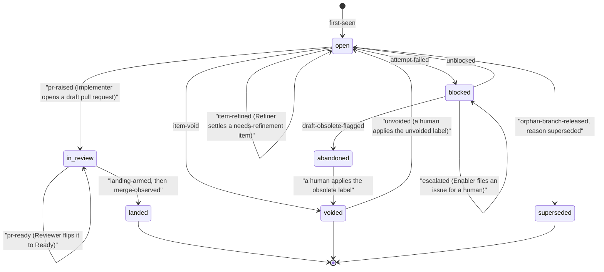

# The life of an item

This page traces one item of work end to end: where it comes from, how it
is picked, how the pipeline stops two nodes from doing it twice, what
happens while it is implemented and reviewed, and the three ways it can
leave the system without landing. See [Architecture](architecture.md) for
what each actor named below is, and
[The Landing Gate and merge autonomy](landing-gate.md) for what happens
once a pull request is ready.

## Sources and bands

An item reaches the Co-Ordinator from one of several sources: an ordinary
GitHub `issues` candidate (and tech-debt, which is simply an issue labelled
`pw::type:tech-debt`), review feedback on a pull request this pipeline
raised, a pull request whose base has moved and now conflicts, one GitHub
dequeued from a merge queue, a pull request a human comment left
unreconciled against the Landing Gate, an abandoned draft a prior cycle left
unfinished, a security or code-quality finding, or a repository-review
recommendation. An `issues` candidate also carries a priority band — GitHub's
own `Priority` field: `Urgent`, `High`, `Medium` (the default when unset), or
`Low` — which orders the Co-Ordinator's walk; the band is spent at gathering
time and is gone from the finished work order.

Authoritative: `docs/spec/implementation/requirements/co-ordinator-01.md`,
requirements 15–17; `docs/concepts/glossary.md`, entries "Band" and "Claim"
(for the `source` field); `config.schema.json`'s `sourceToken`.

## Refinement

An item too vague to select — no acceptance criterion, an unbounded scope —
needs the Refiner before the Co-Ordinator will choose it. The Refiner is a
headless Claude Code invocation, engaged at the end of a cycle, that writes
the specification an under-specified item lacks before it has to be blocked
and wait for the Enabler to reach it. It reaches exactly one of two
verdicts: `refined` (a specification is now posted, typically as a comment
on the item's own issue) or `needs-refinement` (only a human can supply what
is missing). It also bands every open issue whose `Priority` is unset, a
one-way ratchet the Script alone enforces. Its powers are deliberately
narrower than the Enabler's: it writes no code, raises no pull request, and
can neither escalate nor void.

Authoritative: `docs/spec/implementation/requirements/refiner.md`,
requirement 39 and requirements 39c, 39d, 39g.

## Selection

The Co-Ordinator is a headless Claude Code invocation, read-only against
GitHub, that selects at most one well-scoped item per cycle per repository
and emits a work order — it implements nothing itself. It ranks the
qualifying candidates best-first and returns the first one whose claim
succeeds (see "The claim" below); only after exhausting every candidate in
every configured repository does a cycle conclude nothing was selected.
Before it is shown any candidate, back-pressure is applied to its input:
once open draft pull requests, `CHANGES_REQUESTED` pull requests, and live
claims reach `max_open_agent_prs`, a cycle stands down from starting new
work rather than adding to the pile, narrowing itself to finishing
already-open work instead.

Authoritative: `docs/spec/implementation/requirements/co-ordinator-01.md`,
requirement 17; `docs/concepts/glossary.md`, entry "Back-pressure"
(requirement 2, step 2).

## The claim

Two machines in the same fleet might otherwise race to start the same item
twice. The Script — never the model — takes an atomic, create-only claim on
an item before the Implementer ever starts, and the node that loses the
race moves on to its next candidate; there is no leader and no lease, only
this one atomic write. For a fresh item the claim *is* a branch:
`agent/<item-ref>`, created at the default branch's own head — a create-only
write that a second node's identical attempt cannot win once the first has
landed. For an item whose branch and pull request already exist — review
feedback, a merge conflict, a dequeued or landing-refused pull request, an
abandoned draft — the claim is instead a create-only file written to the
state repository, since there is no new branch to create.

Authoritative: `docs/spec/implementation/requirements/co-ordinator-01.md`,
requirement 17a; `docs/concepts/glossary.md`, entry "Claim".

## Implementation

The Implementer is a single, non-interactive, non-resumable invocation that
checks out the already-created claim branch, opens a draft pull request
immediately (labelled, in Conventional Commits title form, naming the item
it addresses), and then implements, pushing at meaningful checkpoints
rather than saving everything for one push at the end. It runs the same
checks CI will run, closes the loop on the record it came from (a real
GitHub closing keyword for an issue, plus a `td-record` block for tech
debt), and grades its own diff's review complexity before leaving the pull
request as a draft for the Reviewer.

Authoritative: `docs/spec/implementation/requirements/implementer.md`.

## Review

The Reviewer is the same kind of one-shot invocation, engaged on the
Implementer's branch: it checks the diff against the work order and the
repository's own conventions, fixes what it can fix with confidence
directly on the branch, and otherwise leaves a pull request review comment.
It reconciles any standing human comment, confirms the checks are green and
the pull request is genuinely mergeable against GitHub's own view — never
trusted from its own report — and only then flips the pull request out of
draft.

Authoritative: `docs/spec/implementation/requirements/reviewer.md`.

## The Landing Gate and landing

A pull request the Reviewer has marked ready still has to pass the Landing
Gate before it lands — the chain of gates that decides whether, and by
whom, it may be approved and merged onto the repository's protected default
branch. No model ever pushes to, approves, or merges onto that branch at
any trust level; GitHub's own branch protection enforces this independently
of anything this pipeline decides. The full mechanics — the merge autonomy
ladder, protected paths, the merge budget, and what always stops a landing
— are their own page: [The Landing Gate and merge autonomy](landing-gate.md).

Authoritative: `docs/spec/implementation/landing-gate.md` § "The Landing
Gate".

## The three ways out

Not every item lands. Three outcomes end an item's story without that:

- **Blocked** — real work exists, but something is in the way: a dependency
  has not landed, configuration or credentials are wrong, the item is
  under-specified, or a decision only a human can make is needed. The
  Co-Ordinator re-checks a blocked item itself every cycle and clears it
  once the impediment is gone; an item nothing clears reaches the Enabler
  (see [Escalation](escalation.md)).
- **Void** — there is no work at all: the item is already done, a
  duplicate, or its premise was false. No agent can clear a void item
  itself — the only evidence that would prove it is the reason it is void
  — so a human applies a dedicated label to ask the next cycle to
  reconsider it.
- **Stand-down** — the fleet, or one node, pausing new work rather than any
  single item failing: a usage-limit stand-down lasts until the limit's own
  reset or a probe confirms recovery; a no-op-cycle stand-down lasts until
  something the Co-Ordinator would read has actually changed.

Authoritative: `docs/guides/operating/diagnose-by-symptom.md` § "An item is
blocked or void"; `docs/concepts/glossary.md`, entries "Blocked", "Void",
and "Stand-down".

## State diagram

The states below are the terminal fates the pipeline's own lifecycle record
assigns to every item (`landed`, `voided`, `superseded`, `blocked`,
`abandoned`, `open`); the transitions are the actual event names the shared
log (`log.jsonl`) records.

Authoritative: `docs/reference/flow-schema.md` § "Terminal fates";
`docs/spec/implementation/requirements/logging-and-state-01.md`,
requirement 33 (the event enum; `draft-obsolete-flagged` itself is
requirement 36a's own `flag_obsolete`, logged by a `still-blocked` Enabler
verdict on an item already blocked, in
`docs/spec/implementation/requirements/enabler-01.md`).

## Related pages

- [Architecture](architecture.md) — what each actor named above is
- [The Landing Gate and merge autonomy](landing-gate.md) — who approves and
  lands a pull request
- [Escalation](escalation.md) — how a blocked item reaches the human owner
- [Glossary](glossary.md) — every coined term, defined once
